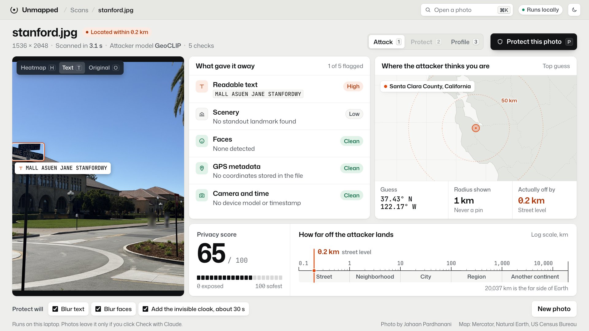
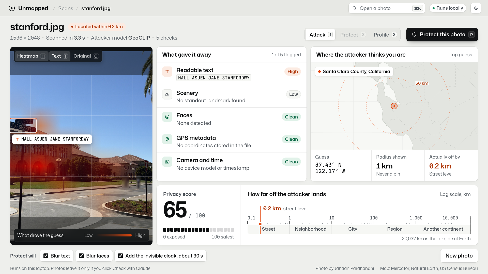
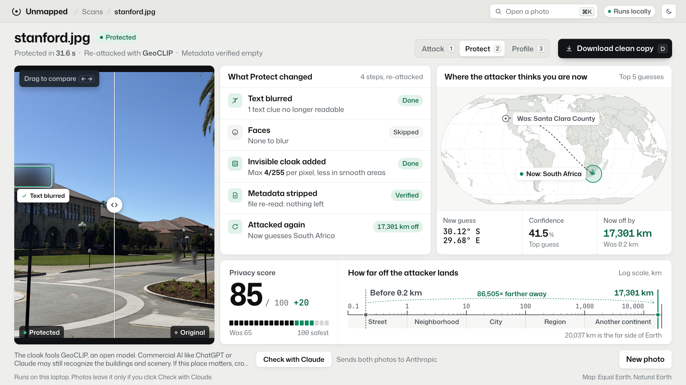
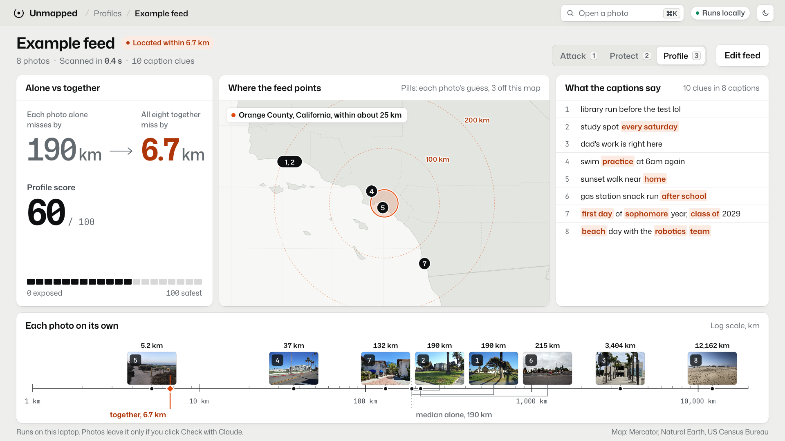

# Unmapped

Your photos, unmapped.

Unmapped shows you where a photo gives away your location, then removes what it can. It reads the metadata, finds signs, faces and other clues, and asks an open-source AI model (GeoCLIP) to guess where the photo was taken. Then it strips the metadata, blurs text and faces, and adds an invisible "cloak" that pushes the model's guess thousands of kilometers away. Everything runs on your own laptop. I built it solo for OCSEFhacks 3 (Advanced division, prompt 2: a data privacy guardrail).



## Screenshots

| Attack | What gave it away |
| --- | --- |
|  |  |

| Protected | Profile mode |
| --- | --- |
|  |  |

## What it does

- Attack: finds GPS and camera metadata, reads visible text, detects faces, names ambient clues like palm trees or architecture, and shows a "what gave it away" heatmap. GeoCLIP's guess goes on an offline map with a rough radius, and the photo gets a privacy score.
- Protect: writes a fresh JPEG with no metadata (and checks that no EXIF or XMP survived), blurs text and faces, and adds the cloak.
- Re-attack: runs the full attack again on the protected file and shows before and after. A "What still gives you away" panel says what the cloak can't hide.
- Profile: combines several photos and scans their captions to show what a whole feed reveals, not just one post.

iPhone HEIC photos work too.

What I measured:

- My Stanford street photo has no GPS in the file, and GeoCLIP still placed it 0.2 km from where I stood. After Protect, its guess was about 17,000 km off.
- On 30 test photos (8 of mine, 22 from Wikimedia Commons), the cloak pushed every guess at least 8,822 km off. That held after resizing to 1080 px with JPEG quality 75, after cropping 10% and recompressing, and at JPEG quality 50.
- The cloak is invisible by the usual measures: PSNR above 41 dB and SSIM above 0.99 on all 30 photos (SSIM 1.0 means identical).
- Profile mode on an example feed of 8 Huntington Beach photos: one photo alone was typically about 190 km from where they were taken. All 8 together narrowed it to 6.7 km.

## How the cloak works

GeoCLIP compares a photo against a gallery of 100,000 places on Earth and gives each one a probability.

1. I compute the expected error: the probability-weighted distance from the real location across all 100,000 places.
2. PyTorch gives the gradient of that error with respect to every pixel.
3. Each step nudges every pixel in the direction (the sign) that makes the error bigger.
4. The total change is capped at 4/255 per color channel, and a texture mask gives smooth areas like sky an even smaller budget, so nothing visible shows up.
5. Every step uses a random crop of the photo, so the cloak still works after someone crops or resizes it.
6. It runs 100 steps, which takes about 30 to 60 seconds per photo on my laptop.

The code is `cloak()` in `backend/geo.py`.

## Run it locally

It needs macOS, because text and face detection use Apple Vision. Apple Silicon is recommended (it runs GeoCLIP on the Mac GPU).

```bash
git clone https://github.com/kidflash2jahaan/Unmapped.git
cd Unmapped
python3 -m venv .venv
.venv/bin/pip install torch geoclip fastapi uvicorn python-multipart pillow pillow-heif numpy transformers ocrmac pyobjc anthropic pydantic
```

The server runs offline, so download the GeoCLIP and CLIP weights once first:

```bash
.venv/bin/python -c "from geoclip import GeoCLIP; from transformers import AutoTokenizer; GeoCLIP(); AutoTokenizer.from_pretrained('openai/clip-vit-large-patch14')"
```

Then start it:

```bash
.venv/bin/python -m uvicorn server:app --app-dir backend --host 127.0.0.1 --port 8000
```

Open http://127.0.0.1:8000. You can upload your own photo or pick one of the built-in examples.

Optional: to turn on the "Test against Claude" check, put `ANTHROPIC_API_KEY=...` in a `.env` file in the project root. That check sends the photo to Anthropic, so it's off unless you add a key and click the button.

`scikit-image` is only needed for `backend/cloak_test.py`, the script I used to measure the cloak.

## Project structure

```
backend/
  server.py        FastAPI app: attack, protect, profile and Claude endpoints, serves the frontend
  geo.py           GeoCLIP guesses, the cloak, and the heatmap
  clues.py         text and face detection (Apple Vision) and ambient clues (CLIP)
  metadata.py      reads GPS and camera info, saves clean JPEGs, checks for leftover metadata
  profiles.py      combines several photos and scans captions
  claude_check.py  optional Test against Claude check
  baseline.py      measures GeoCLIP's error on a set of test photos
  cloak_test.py    measures the cloak after resize, crop and JPEG
frontend/
  index.html       page layout
  app.js           uploads, results, before and after, map
  styles.css       styles
  vendor/          d3, topojson, map data and fonts, so the map works offline
demo/              example photos and examples.json (locations, captions, credits)
```

## Privacy

- Everything runs locally: GeoCLIP, text reading, face detection and the clue finder. The server only listens on 127.0.0.1.
- Nothing gets uploaded anywhere, except when you click the opt-in "Test against Claude" button, which sends that one photo to Anthropic's API.
- The demo photos in this repo have their metadata stripped.

## Limitations and what's next

- The cloak was measured against open geolocation models like GeoCLIP. It doesn't reliably carry over to the biggest commercial AI models, which can still recognize famous landmarks. That's why Unmapped also blurs text and tells you what's still visible.
- When a photo has no GPS and isn't one of my examples, the cloak pushes away from GeoCLIP's own first guess, not the true location.
- Protecting a photo takes 30 to 60 seconds, and it only runs on a Mac for now.

Next:

- A browser extension that strips and cloaks photos when you upload them
- A phone app
- Background blur
- A cloak trained against several models at once, to have a better chance against commercial AI

## Credits

- GeoCLIP: Vicente Vivanco Cepeda, Gaurav Kumar Nayak, Mubarak Shah, "GeoCLIP: Clip-Inspired Alignment between Locations and Images for Effective Worldwide Geo-localization", NeurIPS 2023 (MIT license)
- OpenAI CLIP
- Map data: Natural Earth and US Census Bureau boundaries, via world-atlas and us-atlas
- d3 and topojson-client (ISC)
- Fonts: Mona Sans and JetBrains Mono (SIL Open Font License 1.1)

Photos in `demo/`:

- Stanford street corner, mall at night, Dublin shopping street, parking lot: photos by me (Jahaan Pardhanani)
- Downtown at dusk (Hilo): dronepicr, CC BY 2.0, via Wikimedia Commons, resized
- Rainy park (Beaverton): Another Believer, CC BY-SA 4.0, via Wikimedia Commons, resized
- Parking lot and storefronts (Hilo): Peter Gill, CC BY 3.0, via Wikimedia Commons, resized
- Small-town main street (Brattleboro): Artaxerxes, CC BY-SA 4.0, via Wikimedia Commons, resized
- Canyon town street (Bisbee): Clay Gilliland from Chandler, U.S.A., CC BY-SA 2.0, via Wikimedia Commons, resized
- Triangle Park and Main Street Library (two photos): Kathy92648, CC BY-SA 3.0, via Wikimedia Commons, resized
- Huntington Beach Police Department: Uzbekman24, CC BY 4.0, via Wikimedia Commons, resized
- Huntington Beach Gymnasium and Pool: Kathy92648, CC BY-SA 3.0, via Wikimedia Commons, resized
- Bolsa Chica Ecological Reserve: Crishazzard, CC BY-SA 4.0, via Wikimedia Commons, resized
- Brookhurst St and Talbert Ave: Amin Eshaiker, CC BY-SA 3.0, via Wikimedia Commons, resized
- Old World Village: Dialh, CC BY-SA 4.0, via Wikimedia Commons, resized
- Huntington State Beach: FASTILY, CC BY-SA 4.0, via Wikimedia Commons, resized

Full source links for each Wikimedia photo are in `demo/examples.json`. The captions in the Huntington Beach example feed are made up; no real person's feed was used.
